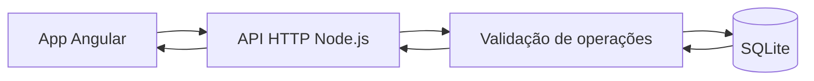

# Guia de apresentação e arquitetura — Banco Escola

## 1. Problema e proposta

O trabalho acadêmico propõe uma aplicação web para **movimentações financeiras fictícias** com regras de negócio que imitam, em nível educacional, um app de banco digital. Resolve registro, consulta e organização de saldos simulados, sem criar operações financeiras reais.

## 2. Objetivos

- Interface responsiva e navegação semelhante a um banco digital, mas com identidade original.
- CRUD básico de contas de demonstração; movimentações registradas sem exclusão pela interface.
- Entradas, saídas, transferências internas, agendamentos, metas, cartões fictícios e orçamento.
- Backend com validação e saldos em **centavos inteiros**.
- Extrato e comprovantes fictícios, pesquisa e CSV.
- Persistência SQLite e testes automatizados.

## 3. Camadas

**Frontend** — Angular 22, TypeScript, HTML e CSS. Interface, formulários, validações de campos, feedback, navegação responsiva, extrato e dashboard.

**Backend** — Node.js 24. Servidor HTTP nativo, autenticação de operador por token, endpoints REST e regras de negócio. O backend controla o saldo, não o navegador.

**Banco** — SQLite nativo. Contas, lançamentos, transferências, reservas, cartões fictícios, limites, favoritos, auditoria e orçamentos.

## 4. Regras importantes

| Regra | Implementação |
|---|---|
| Valor monetário | Inteiro em centavos (`amount_cents`) |
| Entrada | Soma ao saldo da conta |
| Saída | Subtrai apenas quando o saldo permite |
| Transferência interna | Uma transação SQLite: débito na origem e crédito no destino |
| Operação repetida | A mesma `request_key` não duplica a transferência |
| Limites de Pix | Limite por operação e limite diário configurável para cada conta DEMO |
| Cartão bloqueado | Impede saídas selecionadas como débito de cartão |
| Reserva | Reduz conta disponível e aumenta saldo guardado |
| Resgate | Reduz saldo guardado e aumenta disponível |
| Agendamento | Criado como pendente; executado por comando explícito após a data |
| Comprovante | Inclui aviso de que não é documento bancário real |

## 5. Exemplo de histórico

Conta inicial DEMO: R$ 3.500,00 de entrada e operações de saída e entrada posteriores. Uma nova transferência de R$ 25,00 para outra conta DEMO gera **dois registros** e conserva a soma dos saldos das duas contas. Dados de amostra são identificados como fictícios.

## 6. Tabelas principais

- `bank_accounts` — titulares e contas DEMO.
- `bank_entries` — livro de lançamentos (entradas e saídas).
- `bank_entry_categories` — categoria e identificação de transferência por lançamento.
- `bank_transfers` — pares de lançamentos com idempotência.
- `bank_goals` e `bank_goal_events` — metas e histórico.
- `bank_cards` — cartão fictício e status.
- `bank_bills` — boletos simulados.
- `bank_schedules` — agenda de operações com execução manual.
- `bank_budgets` — orçamento mensal por categoria.
- `bank_favorites` — destinatários favoritos internos.
- `bank_transfer_limits` — limites de Pix para demonstração.
- `bank_audit` — histórico de ações.

## 7. Requisitos não funcionais

- Responsividade: computador, tablet e celular.
- Acessibilidade: controles clicáveis com foco visível e navegação consistente.
- Persistência: dados locais armazenados em arquivo SQLite.
- Confiabilidade: validações no backend, uso de transações e testes de integração.
- Segurança didática: token local e avisos constantes de simulação.

## 8. Limitações

Não existe multiusuário com permissões isoladas, agência bancária válida, Pix integrado ao Bacen, Open Finance, cartão válido, pagamentos de boletos reais, antifraude bancário, autenticação forte, backup automatizado ou infraestrutura de produção.

É um **protótipo educacional**, não um serviço bancário. O token de operador único oferece proteção básica para uso local, **não** segurança bancária de produção.

## 9. Referências utilizadas para pesquisa de recursos

- Nubank — Conta digital: https://nubank.com.br/nu/conta
- Itaú — Aplicativo: https://www.itau.com.br/app-itau
- Itaú — Controle de gastos: https://www.itau.com.br/controle-de-gastos
- Inter — Detalhes das transações: https://ajuda.inter.co/conta-digital-pessoa-fisica-e-mei/quais-informacoes-aparecem-no-detalhamento-das-transacoes-bancarias
- W3C — WCAG 2.2: https://www.w3.org/TR/WCAG22/
- OWASP — API Security Top 10: https://owasp.org/API-Security/

Referências sobre **padrões de funcionalidades**, não reprodução de marcas.
