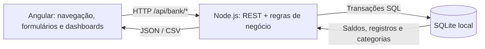

# Banco Escola — Relatório técnico de refinamento e validação

**Projeto acadêmico SETREM · Simulador de banco digital · Edição de novembro de 2026**

> **Aviso obrigatório:** esta aplicação é inteiramente fictícia. Não executa Pix real, pagamentos, transferências para outras instituições, operações com cartão, aplicação financeira ou abertura de conta bancária verdadeira. Todo comprovante é demonstrativo, sem validade legal ou financeira.

## 1. Objetivo do trabalho

Desenvolver uma aplicação full-stack com interface de banco digital e um conjunto demonstrável de regras de negócio para **cadastro de contas fictícias, controle de saldo, movimentações de entrada e saída, transferências internas simuladas, comprovantes e visualização financeira**.

A solução reúne três disciplinas técnicas: **interface e experiência do usuário** (Angular), **programação e regras de negócio** (Node.js) e **persistência estruturada** (SQLite).

## 2. Pesquisa utilizada e método aplicado

A revisão utilizou uma **análise de referências públicas e avaliação heurística** (não uma pesquisa de campo com participantes). Os critérios abaixo foram convertidos em escolhas verificáveis de implementação:

| Base consultada | Princípio identificado | Decisão no Banco Escola |
|---|---|---|
| Nielsen Norman Group, *8 Design Guidelines for Complex Applications* | Hierarquia, busca visual e redução de carga cognitiva | Destaque para saldo, movimentações e poucas ações prioritárias no início; módulos secundários agrupados em navegação |
| Android Developers, *Layouts and navigation patterns* | Navegação adaptativa ao tamanho de tela | Menu lateral no desktop e barra inferior no celular |
| W3C, *WCAG 2.2* | Foco visível, interação por teclado, alvos de toque e identificação dos formulários | Estados de foco, rótulos, botões maiores, mensagens de erro e fechamento de revisões com tecla Escape |
| OWASP, *API Security Top 10 (2023)* | Validar autorização, entradas e operações no servidor | Token de operador, validações de valores inteiros, categorias, limites e saldo no Node.js; não confiar apenas no Angular |
| Boas práticas de prevenção de erros em operações financeiras | Dar oportunidade de verificar valores antes de confirmar | Tela de revisão para Pix e boleto de demonstração, com origem, favorecido, valor e saldo previsto |

**Referências consultadas:**

1. NIELSEN NORMAN GROUP. *8 Design Guidelines for Complex Applications*. https://www.nngroup.com/articles/complex-application-design/
2. ANDROID DEVELOPERS. *Layouts and navigation patterns*. https://developer.android.com/design/ui/mobile/guides/layout-and-content/layout-and-nav-patterns
3. W3C. *Web Content Accessibility Guidelines (WCAG) 2.2*. https://www.w3.org/TR/WCAG22/
4. OWASP. *API Security Top 10 — 2023*. https://owasp.org/API-Security/

**Limite da pesquisa:** não foram realizados testes com usuários reais, análises biométricas, auditoria independente de acessibilidade ou homologação regulatória. Aplicar princípios não equivale a certificação WCAG nem de segurança bancária.

## 3. Funcionalidades disponibilizadas

| Módulo | Dados e operações demonstráveis |
|---|---|
| Início | Identificação da conta, saldo, valor reservado, cartão fictício, ações rápidas, últimos lançamentos e resumo financeiro |
| Contas | Identificações SIM-XXXXX, titulares fictícios, contas de exemplo e criação de contas |
| Entradas e saídas | Data, descrição, categoria, método simulado, referência, valor inteiro em centavos e saldo calculado |
| Pix fictício | Transferência entre contas DEMO, registro de débito e crédito na mesma transação, bloqueio de saldo insuficiente e limites |
| Pagamentos | Boleto inteiramente fictício por referência demonstrativa; confirmação prévia e proteção contra referência duplicada |
| Extrato | Saldo após lançamento, pesquisa por texto e categoria, filtro por período e tipo, CSV e comprovante |
| Agendamentos | Programação de Pix interno ou boleto DEMO; execução manual após data prevista e cancelamento |
| Metas | Guardar e resgatar de saldos de reserva sem criar receita ou despesa operacional |
| Cartão de demonstração | Visual de cartão sem número financeiro real, controle de bloqueio de débito fictício |
| Controle financeiro | Categorias, orçamento mensal, gráfico de evolução, detalhamento tabular de meses e separação de transferências/reservas |
| Preferências | Saldos ocultáveis, contatos favoritos, limites de transferência DEMO e encerramento de sessão |
| Auditoria | Histórico simplificado de operações e alterações, exclusivamente para demonstração acadêmica |

## 4. Arquitetura



**Frontend:** Angular, TypeScript e CSS responsivo, com uma interface visual original. As operações complexas não são calculadas exclusivamente no navegador.

**Backend:** Node.js 24, API HTTP nativa, validação de entrada, autenticação por token de operador, consistência de contas e saldos.

**Banco de dados:** SQLite local com as tabelas de contas, lançamentos, categorias, transferências, pagamentos, metas, cartões, agenda, favoritos, limites e trilha de ações.

### Consistência de dados

- Valores são **inteiros em centavos**, evitando erro de arredondamento.
- A API bloqueia saídas sem saldo, inclusive quando a data do lançamento é retroativa.
- Transferências entre contas fictícias registram **débito e crédito juntos** por transação SQLite, com identificador de operação que impede repetição da mesma transferência.
- Entrada/saída manual, categoria e auditoria agora são gravadas **atomicamente**.
- Um boleto simulado com a mesma referência de pagamento na mesma conta não é debitado duas vezes.
- Recursos colocados na meta não são contabilizados como nova despesa, e resgates não viram receita. O gráfico mensal também exclui transferências internas DEMO dessas métricas operacionais.
- O backend verifica novamente as operações após a conferência visual, evitando confiar apenas no estado de formulário do Angular.

### Exemplo de teste de saldo

Saldo inicial fictício: R$ 1.000,00.

1. Entrada de R$ 200,00 → saldo R$ 1.200,00.
2. Saída simulada de R$ 150,00 → saldo R$ 1.050,00.
3. Guardar R$ 100,00 em meta → saldo de conta R$ 950,00 e saldo reservado R$ 100,00.
4. Transferir R$ 50,00 DEMO → conta de origem R$ 900,00 e destino recebe R$ 50,00.
5. Novo débito de R$ 1.000,00 na origem → rejeitado por saldo insuficiente.

Esse é um **cenário exemplificativo de teste**, não um extrato real.

## 5. Entrega e reprodução da aplicação

### Pré-requisitos

Node.js 24, Git e npm, com terminal PowerShell no Windows. Não é necessário Python.

```powershell
git clone https://github.com/GabrielPavlak/formulario-angular.git
cd formulario-angular
npm ci
```

Terminal 1:

```powershell
$env:FORMS_ADMIN_TOKEN="escolha-um-token-local-unico-com-mais-de-16-caracteres"
npm run backend
```

Terminal 2:

```powershell
npm start
```

Acesso local: **http://localhost:4200**. Saúde da API: http://127.0.0.1:8000/api/health. Entre com o token definido no terminal 1.

**Para um projeto já clonado:**

```powershell
git fetch origin
git switch main
git pull origin main
npm ci
```

**Comando de validação completa:**

```powershell
npm run check
```

## 6. Matriz de casos de teste

| Identificador | Cenário de validação | Resultado esperado |
|---|---|---|
| T01 | Entrada de R$ 20,00 | Saldo aumenta em exatamente 2.000 centavos |
| T02 | Saída maior que saldo | Resposta de erro e nenhuma nova movimentação |
| T03 | Falha proposital ao salvar categoria | Lançamento e auditoria revertidos |
| T04 | Transferência interna DEMO | Débito + crédito vinculados e saldo total conservado |
| T05 | Repetir chave de transferência | Não registrar segundo débito |
| T06 | Pagamento DEMO com referência repetida | Segundo pagamento rejeitado |
| T07 | Guardar e resgatar de meta | Patrimônio conservado, saldos correto |
| T08 | Reservas e transferências no gráfico | Não contam como despesas ou receitas operacionais |
| T09 | Pix acima do limite | Recusa e nenhum saldo alterado |
| T10 | Cartão DEMO bloqueado | Débito simulado de cartão rejeitado |
| T11 | Agendamento futuro | Não executar antes da data; execução explícita e não repetível |
| T12 | Conferir Pix antes de enviar | Mostra origem, destino, valor, saldo previsto e requer confirmação |
| T13 | Busca e filtros do extrato | Retorna lançamentos correspondentes sem alterar saldo |
| T14 | API sem token | Recusa requisição privada |

A suíte automatizada cobre esses cenários em diferentes testes. A execução contínua via GitHub Actions é usada como evidência de compilação e testes; **não substitui avaliação visual manual em diferentes navegadores e dispositivos**.

## 7. Roteiro sugerido de demonstração ao professor

1. Mostrar a página inicial com identidade visual, cartões e avisos de simulação.
2. Selecionar uma conta DEMO e explicar saldo em centavos no SQLite.
3. Abrir Pix, selecionar outra conta, informar R$ 25,00 e **revisar antes de confirmar**.
4. Confirmar a operação e abrir o comprovante fictício.
5. Consultar a conta destinatária e conferir o crédito correspondente.
6. Pesquisar o lançamento no extrato por descrição e exportar o CSV.
7. Demonstrar a criação de uma meta e seu reflexo no patrimônio.
8. Abrir análises, explicar categorias e o gráfico com tabela de dados.
9. Mostrar agendamentos, cartão bloqueável, controle de limites e histórico.
10. Abrir README e testes no repositório para explicar a arquitetura e a qualidade técnica.

## 8. Critérios de aceite

- [ ] Build Angular final aprovado no CI.
- [ ] Testes unitários Angular aprovados no CI.
- [ ] Testes Node.js/SQLite aprovados no CI.
- [ ] Conferir manualmente layouts em 360 px, 768 px e 1366 px.
- [ ] Verificar visualmente que não há erro no console do navegador.
- [ ] Confirmar que todos os exemplos indicam **SIMULAÇÃO**.
- [ ] Conferir o fluxo completo de Pix fictício, pagamento e extrato local.
- [ ] Informar ao professor o link da branch `main` e instruções de execução.

## 9. Limitações e evolução futura

O projeto **não é um serviço financeiro**: token administrativo único não equivale a usuários bancários reais; não existem CPF/validação de identidade, senha individual, biometria, MFA, certificação regulatória, prevenção real a fraude, integrações Pix/SPI, boletos registrados, cartões válidos, Open Finance, licenças ou liquidação bancária. Uma versão com dinheiro real exigiria arquitetura substancialmente diferente, autorização por cliente, segurança, trilhas imutáveis e conformidade com normas aplicáveis.

Funcionalidades que podem ser previstas como **trabalhos futuros**, e não como implementadas: cadastro de usuários com permissões individuais, testes E2E em navegadores, relatórios PDF de demonstração, acessibilidade auditada, componentes Angular separados por módulo, backend com migrações versionadas e automação de agendamentos.
